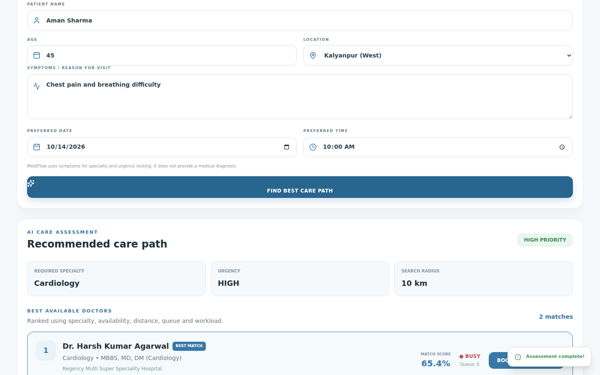
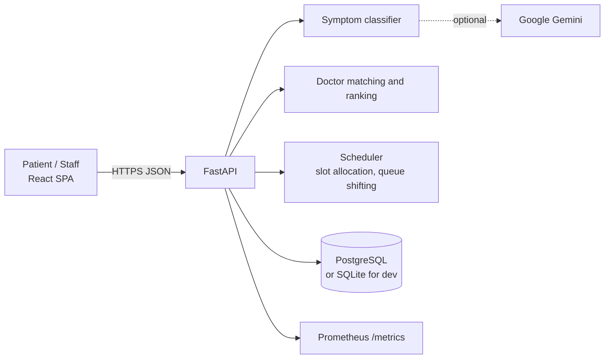
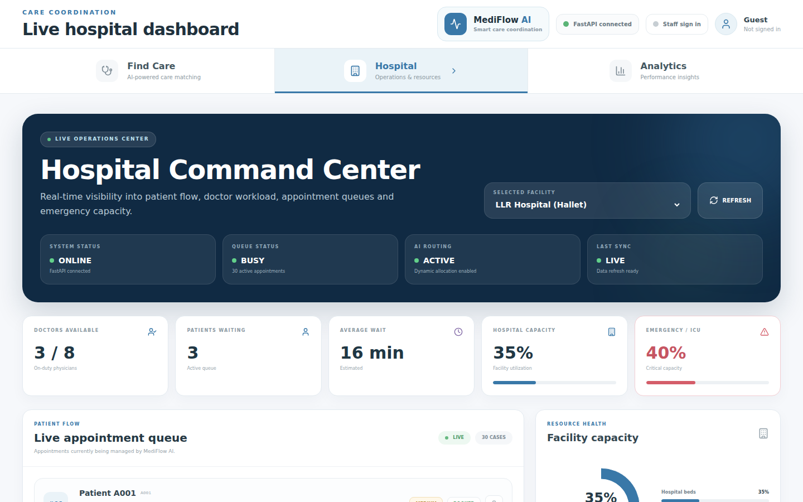
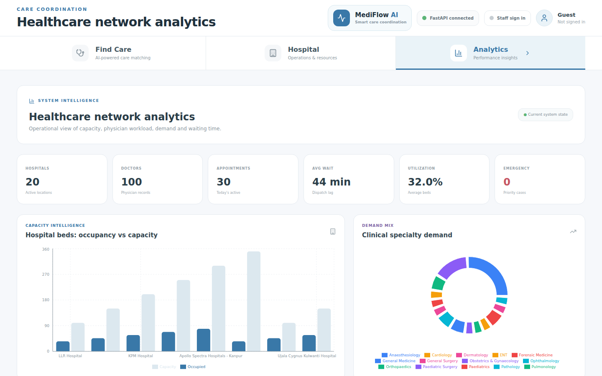
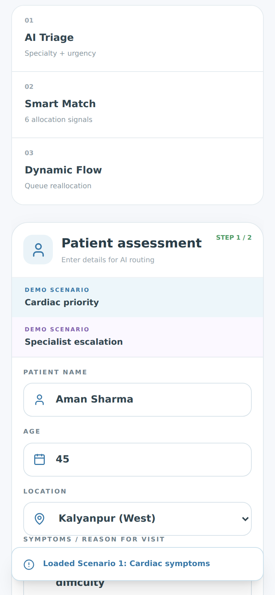
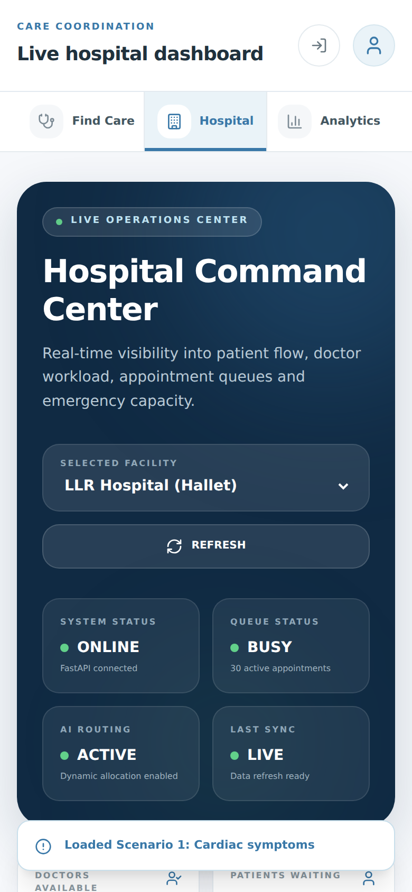

# MediFlow AI

Intelligent appointment scheduling and hospital resource optimization. Patients describe symptoms in plain language; MediFlow classifies the specialty and urgency, ranks nearby doctors by availability, distance, queue and workload, and books the best slot, automatically re-sequencing the queue when an emergency arrives.

[](https://github.com/sujalmishra161-code/MediFlow-AI/actions/workflows/backend-ci.yml)
[](https://github.com/sujalmishra161-code/MediFlow-AI/actions/workflows/frontend-ci.yml)
[](LICENSE)




## Contents

- [Features](#features)
- [How it works](#how-it-works)
- [Screenshots](#screenshots)
- [Tech stack](#tech-stack)
- [Quick start](#quick-start)
- [Configuration](#configuration)
- [API](#api)
- [Authentication and roles](#authentication-and-roles)
- [Security](#security)
- [Testing and quality](#testing-and-quality)
- [Deployment](#deployment)
- [Project structure](#project-structure)
- [Roadmap](#roadmap)
- [Contributing](#contributing)
- [License and disclaimer](#license-and-disclaimer)

## Features

**Patient experience**
- Free-text symptom triage that returns a specialty and urgency level, using Google Gemini when a key is configured and a deterministic local classifier otherwise
- Ranked doctor recommendations scored on specialty match, availability, distance, current queue length and workload, with automatic radius expansion and escalation when no match is found nearby
- Slot preview and booking against the doctor's live schedule

**Hospital operations**
- Live hospital dashboard: doctors on duty, patients waiting, average wait, capacity and emergency load
- Emergency intake that inserts a critical patient at the earliest slot and shifts lower-priority appointments without creating overlaps
- Doctor-unavailable handling that reallocates affected appointments to alternative doctors, and one-click queue rebalancing for overloaded doctors
- Cancellation with automatic pull-forward of later appointments
- Network analytics: utilization, waiting time by specialty, priority mix

**Platform**
- JWT authentication with admin and staff roles, server-side token revocation on logout, and an append-only audit log
- Concurrency-safe booking: row-level locking plus a partial unique index prevent double-booking under simultaneous requests
- Alembic migrations, Prometheus metrics, liveness and readiness probes, structured logging with request IDs
- Responsive interface verified at 320 px through desktop widths, with a cookie-consent banner and accessible form labelling

## How it works



1. **Classify.** The symptom text is mapped to a specialty and an urgency level (LOW, MEDIUM, HIGH, EMERGENCY).
2. **Match.** Doctors of that specialty within a search radius are scored on availability, distance, queue and workload. If nothing qualifies, the radius expands and escalation options are returned.
3. **Schedule.** The scheduler reserves the earliest suitable slot. For HIGH and EMERGENCY cases it displaces later appointments by tracking reserved intervals cumulatively, so shifted appointments never collide with each other.
4. **React.** Cancellations pull the queue forward; a doctor going offline triggers reallocation to the best available alternative.

## Screenshots

| Hospital dashboard | Network analytics |
|---|---|
|  |  |

| Patient intake (mobile) | Hospital dashboard (mobile) |
|---|---|
|  |  |

## Tech stack

| Layer | Technology |
|---|---|
| Backend | FastAPI, SQLAlchemy 2, Alembic, Pydantic v2, Gunicorn with Uvicorn workers |
| Database | PostgreSQL in production, SQLite for local development |
| Auth and security | JWT (python-jose), bcrypt, slowapi rate limiting, security headers, audit log |
| Frontend | React 19, Vite, Tailwind CSS 4, Recharts, Lucide icons |
| AI | Google Gemini (optional) with a local rule-based fallback |
| Observability | Prometheus metrics, structured logs, optional Sentry |
| Tooling | Docker and Compose, GitHub Actions, pytest, ruff, oxlint, Playwright |

## Quick start

### Docker Compose

Runs PostgreSQL, the API and the frontend together.

```bash
git clone https://github.com/sujalmishra161-code/MediFlow-AI.git
cd MediFlow-AI
cp backend/.env.example backend/.env
# set JWT_SECRET_KEY and ADMIN_PASSWORD in backend/.env
docker compose up --build
```

- App: http://localhost:5173
- API documentation (Swagger): http://localhost:8000/docs

### Manual

Requires Python 3.11+ and Node.js 18+.

```bash
# Backend
cd backend
python3 -m venv .venv && source .venv/bin/activate
pip install -r requirements.txt
cp .env.example .env
alembic upgrade head      # create the schema
python seed.py            # load 20 hospitals, 100 doctors, sample appointments
uvicorn main:app --reload

# Frontend (second terminal)
cd frontend
cp .env.example .env
npm install
npm run dev
```

Staff sign-in for the operations actions uses the `ADMIN_EMAIL` and `ADMIN_PASSWORD` from `backend/.env`. The defaults in `.env.example` are for local development only. In production mode the application refuses to start while they are unchanged.

A complete walkthrough with troubleshooting is in [docs/SETUP.md](docs/SETUP.md). `make help` lists the available shortcuts.

## Configuration

All settings are environment variables, documented in [`backend/.env.example`](backend/.env.example). The ones that matter most:

| Variable | Purpose | Default |
|---|---|---|
| `ENV` | `development`, `staging` or `production` | `development` |
| `DATABASE_URL` | SQLAlchemy URL; use PostgreSQL in production | local SQLite file |
| `JWT_SECRET_KEY` | Token signing key; required in production | placeholder |
| `ADMIN_EMAIL` / `ADMIN_PASSWORD` | First admin account, created on first start | placeholders |
| `CORS_ORIGINS` | Comma-separated list of allowed frontend origins | localhost origins |
| `ALLOWED_HOSTS` | Host header allow-list | `*` |
| `GEMINI_API_KEY` | Enables Gemini triage; local classifier is used when unset | unset |
| `RATE_LIMIT_*` | Per-IP limits for default, classify and booking routes | 60, 20, 10 per minute |
| `METRICS_ENABLED` | Exposes Prometheus metrics at `/metrics` | `true` |
| `SENTRY_DSN` | Enables error tracking when set | unset |

With `ENV=production` the app validates its configuration at startup and exits if the JWT secret or admin password is a placeholder, CORS contains a wildcard, or the database is SQLite.

## API

Interactive documentation is served at `/docs` (Swagger UI) and `/redoc`. The full reference with request and response examples is in [docs/API.md](docs/API.md).

| Area | Endpoints |
|---|---|
| Health | `GET /api/health`, `/api/health/live`, `/api/health/ready`, `/metrics` |
| Triage | `POST /api/ai/classify` |
| Patient flow | `POST /api/patient/request`, `GET /api/doctors`, `GET /api/doctors/recommend`, `GET /api/hospitals/nearby` |
| Appointments | `POST /api/appointments`, `GET /api/appointments`, `GET /api/appointments/{id}` |
| Operations | `POST /api/events/emergency`, `/api/events/doctor-unavailable`, `/api/events/cancel`, `/api/optimization/reallocate` |
| Analytics | `GET /api/hospitals/{id}/dashboard`, `GET /api/analytics` |
| Auth | `POST /api/auth/login`, `/refresh`, `/logout`, `/change-password`, `GET /api/auth/me` |
| Admin | `GET /api/admin/appointments/export`, `PATCH /api/admin/doctors/{id}/availability`, `GET /api/admin/dashboard-summary`, `GET /api/admin/audit-log`, `POST /api/admin/staff` |

Example:

```bash
curl -X POST http://localhost:8000/api/ai/classify \
  -H "Content-Type: application/json" \
  -d '{"symptoms": "chest pain and shortness of breath"}'
# {"specialty":"Cardiology","urgency":"HIGH","confidence":0.95}
```

## Authentication and roles

Patient-facing endpoints are public. Operational and administrative endpoints require a bearer token from `POST /api/auth/login`.

| Role | Permissions |
|---|---|
| `staff` | Book and cancel appointments, simulate emergencies and doctor unavailability, toggle doctor availability |
| `admin` | Everything staff can do, plus queue reallocation, CSV export, staff account creation and the audit log |

Patient names are masked for anonymous callers on the public appointment endpoints (first name and last initial) and shown in full only to signed-in staff.

Every authenticated mutating request is recorded in the audit log. Logging out revokes the token server-side, so a copied token stops working immediately rather than at expiry.

## Security

- Passwords hashed with bcrypt; strength policy enforced on creation and change
- Patient identity masked on public endpoints; full names require a staff token
- Token revocation, per-route rate limits on login, refresh, booking, classification and account creation
- Security headers, host-header validation, request body size limit, strict CORS
- Production start-up validation that rejects unsafe configuration
- No secrets in the repository; `.env` files are gitignored

To report a vulnerability, see [SECURITY.md](SECURITY.md).

## Testing and quality

```bash
# Backend (27 tests, includes a multi-threaded double-booking race test)
cd backend && rm -f mediflow.db && alembic upgrade head && python seed.py && pytest -v
ruff check .

# Frontend
cd frontend && npm run lint && npm run build
npm run test:e2e        # Playwright; needs the backend and a built preview running
```

GitHub Actions runs linting, migration apply and round-trip checks, the backend suite, and the frontend lint, build and end-to-end tests on every push.

## Deployment

| Target | Guide |
|---|---|
| Docker Compose on any server | [docs/DEPLOYMENT.md](docs/DEPLOYMENT.md) |
| Render (Blueprint in `render.yaml`) | [docs/DEPLOYMENT.md](docs/DEPLOYMENT.md#2-managed-platforms-railway--render--github-pages) |
| Railway, Netlify, Vercel, GitHub Pages | [docs/DEPLOYMENT.md](docs/DEPLOYMENT.md) |
| Backups and restore | `scripts/backup.sh`, `scripts/restore.sh` |

Database migrations run automatically when the production container starts. See the post-deploy checklist in the deployment guide before exposing the service.

## Project structure

```
MediFlow-AI/
  backend/
    main.py            FastAPI application and routes
    config.py          Environment-driven settings and production validation
    auth.py            JWT, roles, revocation, password policy
    scheduler.py       Slot allocation, queue shifting, pull-forward
    matching.py        Doctor ranking and distance scoring
    ai.py              Symptom classification (Gemini with local fallback)
    models.py          SQLAlchemy models
    alembic/           Database migrations
    test_*.py          Test suites
  frontend/
    src/               React application and components
    tests/e2e/         Playwright end-to-end tests
  docs/                Setup, deployment, API reference, roadmap, screenshots
  scripts/             Database backup and restore
  .github/             CI workflows, issue and pull request templates
  Dockerfile, docker-compose.yml, render.yaml, Makefile
  hospitals.csv, doctors.csv, ...   Reference dataset
```

## Roadmap

Planned work includes patient accounts and history, email and SMS notifications, real-time updates, and compliance hardening ahead of any use with real patient data. See [docs/ROADMAP.md](docs/ROADMAP.md). Release history is in [CHANGELOG.md](CHANGELOG.md).

## Contributing

Contributions are welcome. Read [CONTRIBUTING.md](CONTRIBUTING.md) for the development workflow, and note that this project follows a [Code of Conduct](CODE_OF_CONDUCT.md).

## License and disclaimer

Released under the [MIT License](LICENSE).

MediFlow AI is a scheduling and care-routing tool. It does not provide medical diagnoses and is not a substitute for professional medical judgment. The hospital and doctor dataset is synthetic sample data for the Kanpur region, used for demonstration. Do not use this software with real patient data without completing the compliance work described in the roadmap.
